1. Title
    # Calculator App
2. Description
   A simple command-line calculator built with Python that performs basic and advanced mathematical operations.
3. Features
   - Addition
   - Subtraction
   - Multiplication
   - Division (with zero handling)
   - Modulus (remainder)
   - Power (exponentiation)
   - Square Root
   - Percentage
   - Input validation
   - Error handling
4. How to Run
    1. Make sure Python is installed on your computer
   2. Download the file `calculate.py`
   3. Open terminal/command prompt
   4. Navigate to the folder containing the file
   5. Run: python calculate.py
5. Usage
   1. Choose an operation from the menu by typing a number
   2. Enter the numbers when prompted
   3. View the result
   4. Continue with another calculation or exit
6. Technologies
   - Python 3.x (for example 3.10.14 version)
   - math module (for square root)
7. Author
    - GitHub: ApsarShaik888
8. Screenshot
    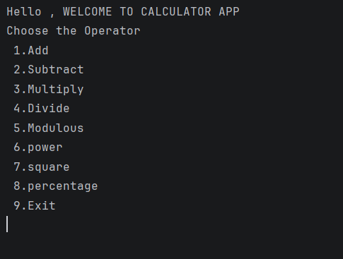
    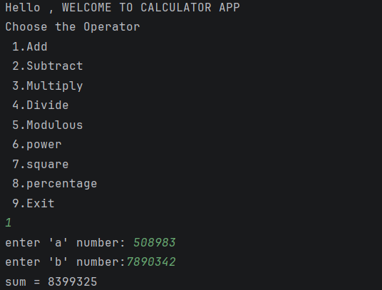
    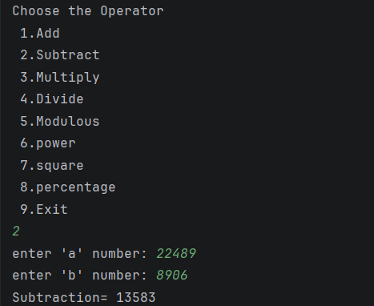
    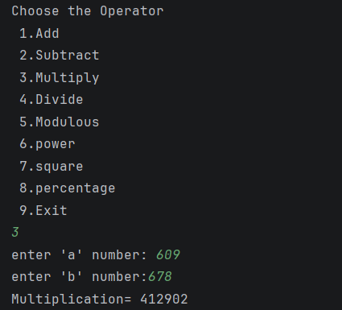
    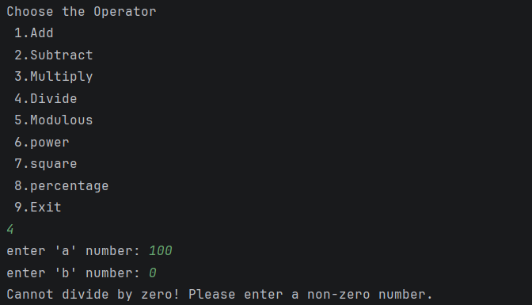
    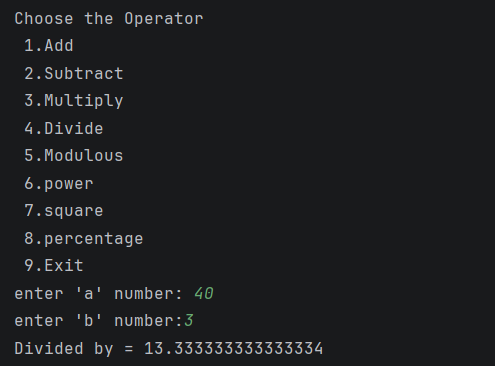
    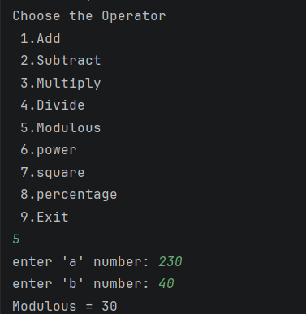
    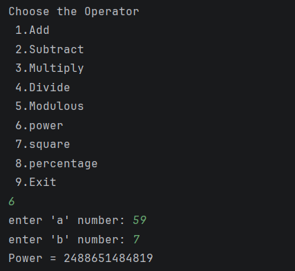
    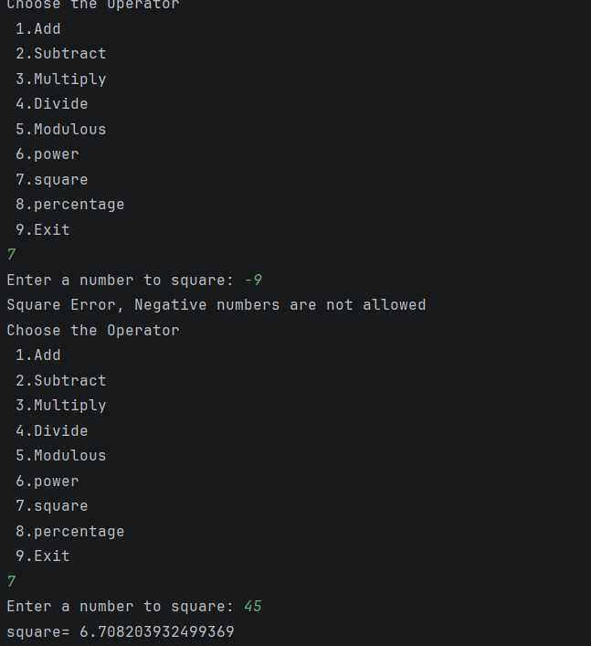
    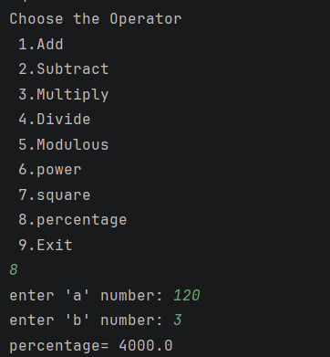
    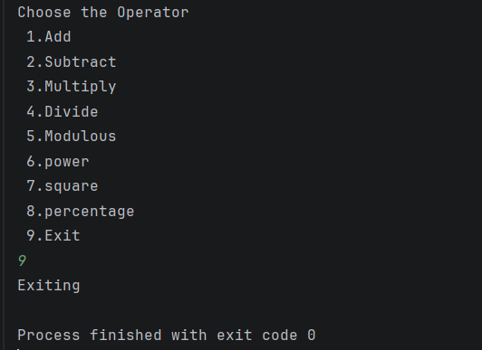


THANK YOU! HAPPY CODING
    
🚀 CI/CD Integration: GitHub + Harness Pipeline
This document outlines the step-by-step process to integrate a GitHub repository with Harness CI using Webhooks to automatically trigger pipelines on code push.

Prerequisites
A GitHub account and a repository containing your code (e.g., Python).
A Harness account (Free tier is sufficient).
A Harness Project and a working Pipeline (e.g., a Python Build Stage).

Step 1: Create a GitHub Personal Access Token (PAT)
Harness needs a secure way to communicate with GitHub.
Go to GitHub -> Settings -> Developer settings -> Personal access tokens (classic).
Click Generate new token.

Select the following required scopes:
repo (Full control of private repositories)
user (Read user profile data)
admin:repo_hook (Full control of repository hooks - crucial for webhooks)
Generate the token and copy it.

Step 2: Configure the Harness GitHub Connector
In Harness, go to Project Settings -> Connectors -> + New Connector -> GitHub.
URL: Enter your GitHub repo URL (e.g., https://github.com/Username/Calculator-App).
Authentication: Select Username and Token.
Username: Your GitHub username.
Token: Paste the PAT generated in Step 1 (store it as a Harness Secret).
API Access: Check Enable API access and select the same token. (This allows Harness to auto-create webhooks).
Click Test Connection and Save.

Step 3: Create the Harness Pipeline
Go to Pipelines -> Create Pipeline.
Add a Build Stage (e.g., running on Harness Cloud).
Configure the Codebase:
Connector: Select your GitHub connector.
Repository: Select your repo.
Add Execution Steps (e.g., a Run step):
Install dependencies: python3 -m pip install pytest-cov
Run code/tests: echo "9" | python3 calculate.py (or pytest).
Save and run the pipeline manually once to ensure it works.

Step 4: Create the Webhook Trigger in Harness
On your pipeline page, click the Triggers tab -> + New Trigger.
Name: Push-Trigger (or similar).
Event: Select Push.
Connector & Repo: Select your GitHub Connector and Repository.
Pipeline Input: Specify the branch (e.g., main) so the trigger knows which code to pull.
Save the Trigger.

Step 5: Verify the Webhook in GitHub
If Harness auto-registered the webhook:
Go to GitHub Repo -> Settings -> Webhooks.
You should see a webhook pointing to a Harness URL.
If Harness failed to auto-register (Manual Setup):
In Harness Triggers, copy the Webhook URL.
In GitHub, click Add webhook.
Payload URL: Paste the Harness URL.
Content type: application/json.
Which events: Select Just the push event.
Click Add webhook.
Step 6: Ensure Branch Names Match
Important: Ensure the branch you are pushing to matches the branch your Harness pipeline and trigger are configured for.
To change your local Git branch from master to main:
bash
git push origin master:main
git branch -m master main
git branch -u origin/main main
✅ How to Test It
Make a small change to your code (e.g., add a comment to calculate.py).
Commit and push to GitHub: git push origin main.

Go to Harness -> Executions.
You should see a new pipeline execution appear, triggered by the Webhook.

🐳 CI/CD Integration: Build & Push Docker Image via Harness to Docker Hub
This document outlines the workflow to automatically build a Docker image from a GitHub repository and push it to Docker Hub whenever code is pushed, using Harness CI.
 Step 1: Create a Repository on Docker Hub:
1. Log in to [Docker Hub](https://hub.docker.com).
2. Click Create repository.
3. Name: `apsarshaik888/calculator-app ` (or your preferred name).
4. Visibility: Choose Public.
5. Click Create.
Step 2: Generate a Docker Hub Personal Access Token (PAT):
Harness needs a secure token to push images, not your account password.
1. In Docker Hub, click your avatar (top right) -> Account settings.
2. Go to Security -> Personal access tokens -> Generate new token.
3. Description: `harness-ci-token`.
4. Permissions: Select Read, Write, Delete.
5. Click Generate and copy the token immediately (you won't see it again).
docker repo-
apsarshaik888/calculator-app
Docker run-
docker login -u apsarshaik888
Docker token-
dc******

Step 3: Create the Docker Hub Connector in Harness:
1. In Harness, go to Project Settings -> Connectors -> + New Connector -> Docker Registry.
2. Name: `Calculator-App-Connector-DockerRegistry`.
3. Provider Type: Docker Hub.
4. URL: `https://index.docker.io/v1/` (for private repos) or `https://index.docker.io/v2/` (for public).
5. Authentication: Select Username and Password.
   Username: Your Docker Hub username (e.g., `apsarshaik`).
   Password: Select Create New Secret  and paste the (Docker token )PAT generated in Step 2.
6. Connectivity Mode: Select Connect through Harness Platform(crucial if using Harness Cloud, as it doesn't require a Delegate).
7. Click Test Connection. Once it passes, click Save.
Step 4: Add a Dockerfile to Your Code:
In your local project folder, create a file named exactly `Dockerfile` (no file extension) with the following content (example for a Python app):
```dockerfile
# Downloads python base image
FROM python:3.10-slim

# Sets the working directory
WORKDIR /app

# Copies local files to the container
COPY . .

# Runs the application
CMD ["python3", "calculate.py"]
```
Commit and push this file to your GitHub repository (ensure you push to the `main` branch).
 Step 5: Edit the Harness Pipeline to Build and Push:
1. Open your existing Harness pipeline and click visual Studio.
2. In the Build Stage (Execution tab), click the `+` button to add a new step after your existing steps.
3. Search for and select Build and Push an image to Docker Registry.
4. Configure the step:
   Name: `Build and Push to DockerHub`
   Container Registry: Select `DockerHub_Connector`.
   Image Repository: `<your-dockerhub-username>/calculator-app-harness-ci` (e.g., `apsarshaik888/calculator-app-harness-ci`).
   Tags: `latest` (or `<+pipeline.sequenceId>` to version them).
   Dockerfile: `Dockerfile`.
   Context: `.` (current directory).
5. Click Apply Changes and Save the pipeline.
Step 6: Trigger and Verify:
1. Make any small change to your code and push it to the `main` branch.
2. The GitHub Webhook triggers the Harness pipeline automatically.
3. Go to Harness -> Executions and watch the pipeline run.
4. Once successful, go to your Docker Hub Repository. You will see the new image with the `latest` tag pushed seconds ago.
### 🎉 Congratulations!
 

