1. Title
    # Calculator App
2. Description
   A simple command-line calculator built with Python that performs basic and advanced mathematical operations.
3. Features
   - Addition
   - Subtraction
   - Multiplication
   - Division (with zero handling)
   - Modulus (remainder)
   - Power (exponentiation)
   - Square Root
   - Percentage
   - Input validation
   - Error handling
4. How to Run
    1. Make sure Python is installed on your computer
   2. Download the file `calculate.py`
   3. Open terminal/command prompt
   4. Navigate to the folder containing the file
   5. Run: python calculate.py
5. Usage
   1. Choose an operation from the menu by typing a number
   2. Enter the numbers when prompted
   3. View the result
   4. Continue with another calculation or exit
6. Technologies
   - Python 3.x
   - math module (for square root)
7. Author
    - GitHub: ApsarShaik888
8. Screenshot
    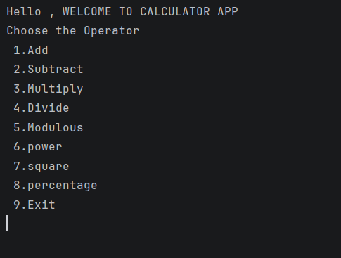
    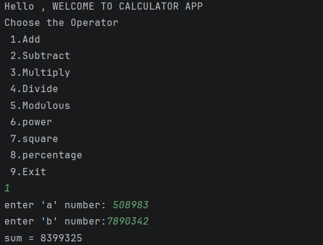
    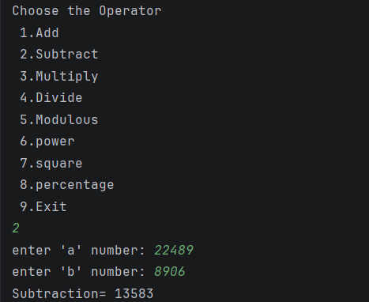
    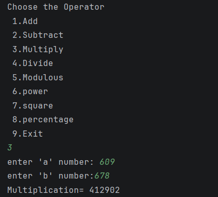
    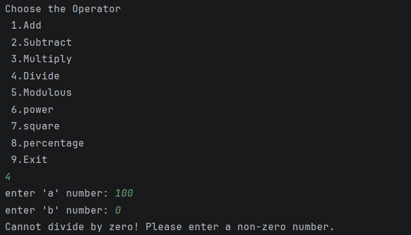
    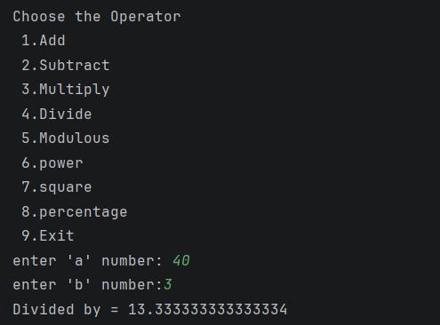
    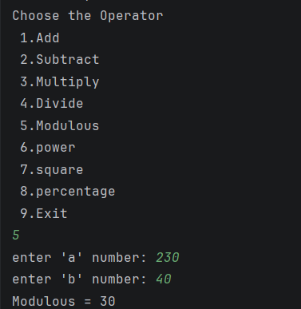
    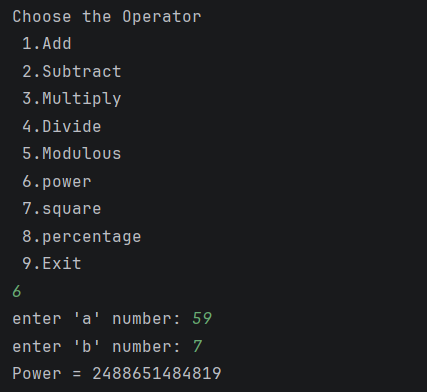
    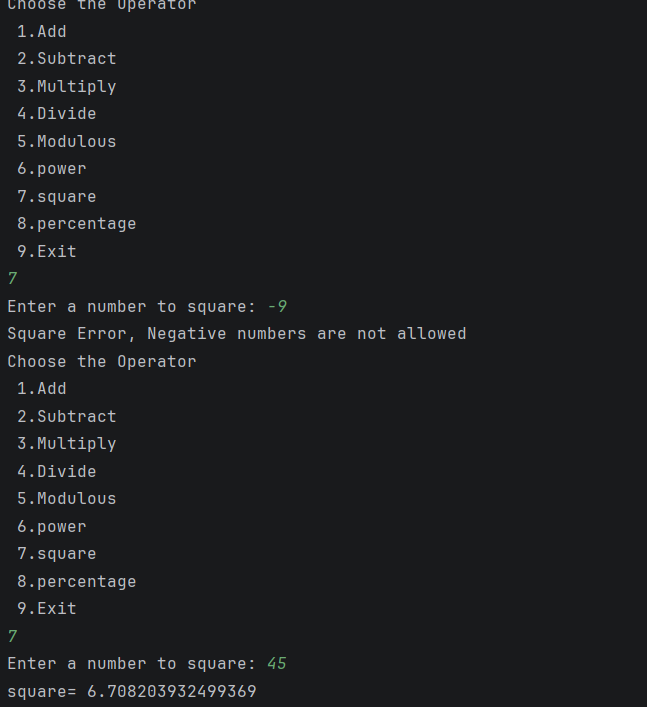
    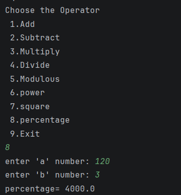
    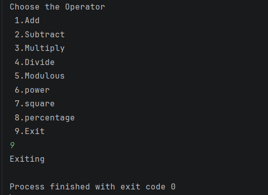

THANK YOU! HAPPY CODING
    
    
